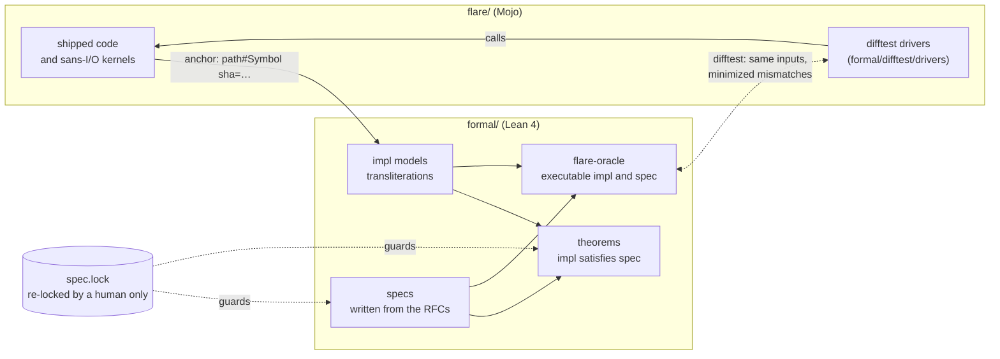
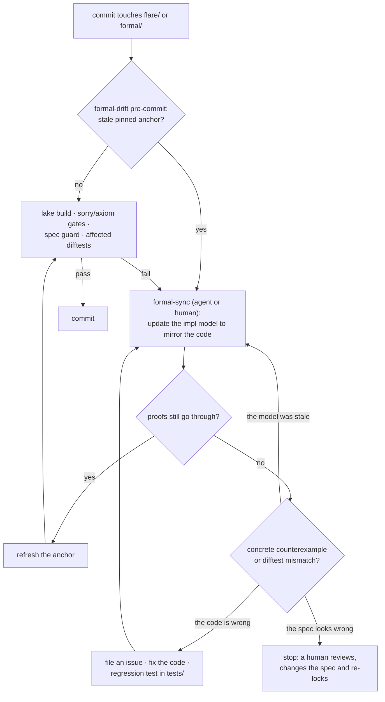

# flare/formal

These are Lean 4 models of flare, proofs about them, and the tooling that keeps them in sync with the Mojo code. [`REPORT.md`](REPORT.md) describes the models and the 138 findings of the 0.12 audit, all of them fixed.

## Design

A one-off audit finds bugs once, and then its models rot as the code moves on. The design here aims to keep the proofs about the code that ships, at a maintenance cost that scales with the change rather than with the codebase. Four mechanisms connect the Mojo and the Lean sides:



- **Anchors** tie each impl model to the Mojo symbols it transliterates, by a hash of their normalized source. Changing the code makes the anchor stale, and `tiers.toml` says which stale anchors block a commit (pinned) and which only warn (tracked).
- **The spec lock** fingerprints every theorem statement and spec definition. Proofs and impl models can change freely, but the claims can't be weakened to get a proof through: only a human re-locks.
- **Differential tests** catch what a proof can't, a model that doesn't match the code. The Lean models compile to an oracle that runs against the real Mojo functions on the same inputs.
- **Verified kernels** handle large changes. Rather than model thousands of new lines, the change routes its critical decision through a small sans-I/O function that gets a spec, a proof and a difftest.

Each commit that touches `flare/` or `formal/` goes through this loop:



**Prior art.** Each piece has precedent:
- AWS's Cedar keeps Lean models of its authorizer and validator, proves properties about them, and differentially tests them against the production Rust code ("verification-guided development").
- s2n-tls re-runs its SAW proofs in CI, so a code change that breaks a proof fails the build.
- seL4 proves that its C code refines an abstract specification.

What flare adds is the upkeep around those ideas: source-hash anchors with tiers, so a change re-checks only the models it touched; a spec lock that machines can't update; verified kernels as the unit of verification for large changes; and agent hooks that let an AI do the model upkeep while blocking it from weakening a theorem or skipping the gate. We don't know of another project that combines these. The work is a transliteration plus proofs, not a verified compiler, so the trust base below still applies.

## Build and check

```bash
pixi run -e formal formal-build    # lake build (core Lean 4.33, no Mathlib)
pixi run -e formal formal-check    # no sorry/axiom/native_decide, #print axioms audit
python3 formal/scripts/stitch_report.py   # rebuild REPORT.md from report/ (formal-check fails if stale)
pixi run -e formal formal-status   # anchors, spec guard, difftest, verified kernels on one screen
pixi run -e formal difftest        # Lean models vs the Mojo code on generated inputs
```

## Layout

| Path | Contents |
|---|---|
| `Flare/Core/` | bytes, Mojo-width words, the LTS/refinement vocabulary, environment assumptions (hypotheses, not axioms) |
| `Flare/L1_Encoding/` | pure codecs: byte order, sockaddr, cursors, UTF-8 (including lossy decoding), QUIC and protobuf varints, HPACK integers, Huffman against RFC 7541 Appendix B, civil time in `Int64`, Mojo's `Int(String)` |
| `Flare/L2_Machine/` | OS-facing abstract machines: sockets, write loops, reactor, timer wheel (including `UInt64` time and jump order), io_uring rings, frame demux, queues, pools, UDP batch `msghdr` layout, UNIX listener takeover, hostname validation, Happy Eyeballs order |
| `Flare/L3_Protocol/` | HTTP/1.1 server and client framing, WebSocket frames and handshakes, HTTP/2 + HPACK (with a refinement of the RFC 9113 §5.1 stream states), QUIC (stream states, ACK generation, transport parameters), QPACK, HTTP/3 |
| `Flare/L4_App/` | connection state machine (with liveness, streaming bodies, TLS interest, `100 Continue`), router, middleware, negotiation, CORS, rate limit, cookies, redirects, client pool and leases, drain, h2c and WebSocket hand-off |
| `Flare/L5_Concurrency/` | interleaving semantics: watchdog, AsyncRT cell, thread handles, scheduler, shared listener, start/teardown bookkeeping |
| `Flare/Machine.lean` | the top-level network abstract machine (one reactor worker) that composes the layers |
| `Flare/MachineHttp.lean` | that machine running the HTTP/1.1 connection state machine (`L4_App/ConnSM`) |
| `Flare/MachineWorkers.lean` | several workers sharing one fd table; worker progress |
| `Flare/MachineWheel.lean` | that machine on the real timer wheel (`L2_Machine/TimerWheel`), any firing order |
| `Flare/Kernels/` | verified kernels: small sans-I/O pieces of a larger change, with a spec, proofs and a difftest (see `obligations/`) |
| `Flare/Audit.lean`, `Flare/Audit/*.lean` | `#print axioms` lines for the headline theorems |
| `report/` | per-layer report sections, stitched into `REPORT.md` by `scripts/stitch_report.py` |
| `Oracle/` | the `flare-oracle` executable: Lean impl and spec models as functions over raw bytes, for the difftest |
| `difftest/` | difftest runner, per-family Mojo drivers, target manifest, regression corpus |
| `obligations/` | one record per verified kernel |
| `tiers.toml`, `spec.lock` | which models block commits; fingerprints of every theorem statement and spec definition |
| `scripts/` | `check.sh`, `anchors.py`, `spec_guard.py`, `status.py`, `precommit.sh`, `stitch_report.py` |

## Conventions

**Fidelity anchor.** Every impl model's doc comment names the Mojo symbols it transliterates and a hash of their source:

```lean
/-- mirrors flare/quic/varint.mojo#decode_varint sha=2fbdb2fed88f at=59bda50f -/
```

- **Symbols.** `Struct.method` for a method; `Struct` for the struct minus its methods; a module-level `def`, `comptime` or `alias` by name; `name@2` for the second overload. `+` joins several symbols.
- **Hash.** `sha` covers the normalized source: comments, docstrings and line wrapping are dropped, relative indentation is kept. A comment-only or reformatting change keeps the anchor fresh.
- **Commit.** `at` is the commit where someone last confirmed that the model matches.
- **Staleness.** When the hash differs, the anchor is *stale*: the code changed, and the model may not match any more. When the symbol no longer exists, it is *missing*.

```bash
python3 formal/scripts/anchors.py who-models flare/x.mojo:LINE   # models (and kernels) of this code
python3 formal/scripts/anchors.py check [--staged | --base REV]   # stale anchors (only the ones a change touched)
python3 formal/scripts/anchors.py make 'flare/x.mojo#Sym'         # a fresh anchor for a new model
python3 formal/scripts/anchors.py refresh formal/F.lean:LINE      # after the model was brought in line
```

Prose `file:line @59bda50` references in module docs are historical and are not checked.

**Tiers** (`tiers.toml`):
- **Pinned.** A stale pinned anchor blocks the commit. Pinned models are the core codecs and protocol machines, plus every verified kernel.
- **Tracked.** A stale tracked anchor only prints a warning.
- **Archived.** Never checked. Empty at present: models describe the shipped code only.

**Spec guard** (`spec.lock`). An impl model follows the code and may change freely. What the proofs claim may not change without a human looking. `scripts/spec_guard.py` fingerprints two things:
- the statement (not the proof) of every theorem;
- the full text of every spec definition. A spec definition is any of: a `spec*` or `*Spec` name, a `Prop`-valued def, any declaration in a `*Spec.lean` or `*Rfc.lean` file, or a declaration whose doc comment contains `[spec]`.

`formal-check` and the pre-commit hook fail when a locked entry changes or disappears, or when a new spec definition appears. New theorems are allowed. After reviewing the change, a human runs `pixi run -e formal formal-spec-lock`. Agents must not, and a Cursor hook denies it.

**Spec vs Impl.** Each component pairs two things:

- `spec`: written from the RFC and independent of flare.
- `impl`: a transliteration of the Mojo code, keeping its control flow, fixed-width arithmetic (`UInt64`, `Int64` wrap for Mojo `Int`, wrapping `UInt32` ring counters) and limits.

Theorems relate the two: refinement, round trips, invariants, termination and progress, no overflow, and chunking independence.

**Semantics.** Pure codecs are total functions. Stateful components are small-step LTSs (`Flare.LTS`), with an executable step function and a lemma that the two agree.

**Issues.** When a proof or a difftest shows the code is wrong:

1. File a GitHub issue with the evidence: the concrete input on which `spec (impl input)` fails, or the minimized difftest case.
2. Land the fix with a regression test in `tests/`. A difftest find also keeps its minimized case in `difftest/regressions/`.
3. In the same change, bring the impl model in line with the fixed code and refresh its anchor. Models do not keep pre-fix variants; git has the history. The 0.12 audit's per-finding counterexamples (`Flare/Bugs/`) and Mojo repros (`repro/`) are at the tag `formal-audit-0.12`.

**Trust base.**

- Environment facts are hypotheses in `Flare/Core/Assumptions.lean`, never `axiom`s.
- OpenSSL, rustls and zlib are black boxes.
- `native_decide` is not allowed.

## Differential testing

A transliteration can be wrong in ways no proof notices, because the proof is about the model, not the code. The difftest runs the Lean model and the real Mojo code on the same inputs and compares their answers.

- `Oracle/Registry.lean` lists the targets. Each one turns raw bytes into an answer string via the impl model and, where the model has one, an executable spec.
- `difftest/drivers/dt_<family>.mojo` produces the same answer string from the real flare function.
- `difftest/run.py` generates inputs from typed generators plus mutated seeds from the `fuzz/` harnesses, and runs both sides. Each mismatch is classified:
  - **drift**: the Mojo code and the Lean impl disagree.
  - **spec**: the Lean impl and the Lean spec disagree.
  - **harness**: a driver or the oracle could not answer.

  The runner delta-minimizes every mismatch and appends it to `difftest/regressions/<target>.txt`, which replays on every later run.

```bash
pixi run -e formal difftest                                     # every target, 3000 cases each
python3 formal/difftest/run.py --affected --base HEAD           # targets whose Mojo symbols or models changed
python3 formal/difftest/run.py --targets bufring_ledger.trace   # one target
pixi run -e formal difftest-soak                                # fresh seeds for 10 minutes
```

`difftest/targets.py` maps each target to its anchored Mojo symbols and Lean models; that mapping drives `--affected`. To add a target, see `.agent/skills/formal-difftest/SKILL.md`.

Most targets are single calls into the L1 codecs. Three targets drive state over a whole trace and compare the end result:

- `bufring_ledger.trace` runs the BufLedger kernel over fill and completion events.
- `h1_chunked.resume` runs the incremental chunked-body scanner from a resume cursor.
- `h2_conn.frames` (`Oracle/H2.lean`) feeds frames to a server-role `Connection.handle_frame` and to `handleW`. It threads the HPACK dynamic table through `Hpack.decode` between header blocks.

## Verified kernels

A change of thousands of lines is not verified line by line. Instead it ships with a *kernel*: the few dozen lines that make its critical decision, extracted into a pure sans-I/O function that the big change calls. Each kernel has:

- a Lean spec, written first and approved by a human;
- an impl model anchored to the Mojo kernel;
- theorems connecting the two;
- an oracle target and difftest driver;
- a record in `obligations/<id>.toml`. The record names the kernel, the call sites that must route through it, the theorems, the difftest targets, and what the proof does not cover.

`obligations/uring-bufring-ledger.toml` is the worked example, a retrospective for issue #37. `classify_recv` (`flare/http/_bufring_ledger.mojo`) decides what the io_uring buffer-ring loop does with each receive completion. `Kernels/BufLedger.lean` proves that every completion holding a provided buffer gives it back exactly once, so the ring never drains. When the bug is re-injected into the Mojo kernel, the difftest flags about two thirds of random traces and minimizes them to a 3-byte one (`difftest/regressions/bufring_ledger.trace.txt`). The workflow is in `.agent/skills/formal-kernel/SKILL.md`.

## The factory loop

The `formal-drift` pre-commit hook (`scripts/precommit.sh`) runs on commits that touch `flare/` or `formal/`:

1. `anchors.py check --staged --fail-on pinned`. This fails if the commit changed Mojo code that a pinned model mirrors and did not bring the model along. It reports only anchors this commit touched, not the existing backlog.
2. If `formal/` is staged: `lake build` (incremental), then the grep gates, `REPORT.md` freshness and the spec guard (`check.sh --fast`).
3. `difftest/run.py --quick --affected --staged`: 1000 cases for each target whose symbols or models changed.

A comment-only or formatting change passes in a few seconds; a change to modelled code takes about 10 s plus the time to fix what it finds. `FORMAL_SKIP=1 git commit ...` skips the hook for a one-off; the next commit that touches the same code still sees the stale anchor.

When the hook blocks, bring the models in line (or let an agent do it):

1. In Cursor or Claude Code, run `/formal-verify`, or follow `.agent/skills/formal-sync/SKILL.md` by hand. Update each stale impl model to mirror the new code, re-prove, run the affected difftests, then `anchors.py refresh` the anchors.
2. If a proof breaks because the theorem is now false, either the model is stale or the code has a real bug. A concrete counterexample settles which. A real bug follows the **Issues** convention above. Nobody weakens a theorem to make it pass. The spec guard catches it if someone tries, and only a human re-locks.
3. For a large change to logic that no model covers, `who-models` returns nothing. Propose a verified kernel (`.agent/skills/formal-kernel/SKILL.md`).

The agent side lives in the agent-agnostic `.agent/`. `.cursor/` and `.claude/` symlink its `skills/` and `commands/`, and wire its hooks through `.cursor/hooks.json` and `.claude/settings.json`:
- Three skills: `formal-sync`, `formal-kernel`, `formal-difftest`.
- The `/formal-verify` command.
- Two hooks, each speaking both Cursor's and Claude Code's hook format. A `stop` hook sends the agent back if its turn left pinned anchors stale or touched `spec.lock`. A shell hook denies `formal-spec-lock` and asks before `FORMAL_SKIP=1` or `git commit --no-verify`.

`pixi run -e formal formal-status` shows where everything stands.

### Rules for agents

Every skill above applies these:

1. Never weaken a claim to get a proof through. Do not edit a theorem statement, a spec definition or `spec.lock`, and never run `formal-spec-lock` or `spec_guard.py --lock`. If a spec looks wrong, stop and ask.
2. Never refresh an anchor (`anchors.py refresh`) unless the impl model mirrors the current Mojo code and `lake build` passes.
3. A proof that breaks after a code change is either a stale model or a real bug. Decide which before editing proofs: look for a concrete counterexample (`decide` on a small input) and run the difftest. A real bug follows the **Issues** convention above. Models do not keep pre-fix variants.
4. No `sorry`, `admit`, `axiom` or `native_decide`.
5. Do not bypass the hook with `FORMAL_SKIP=1` unless the user asks for it.
